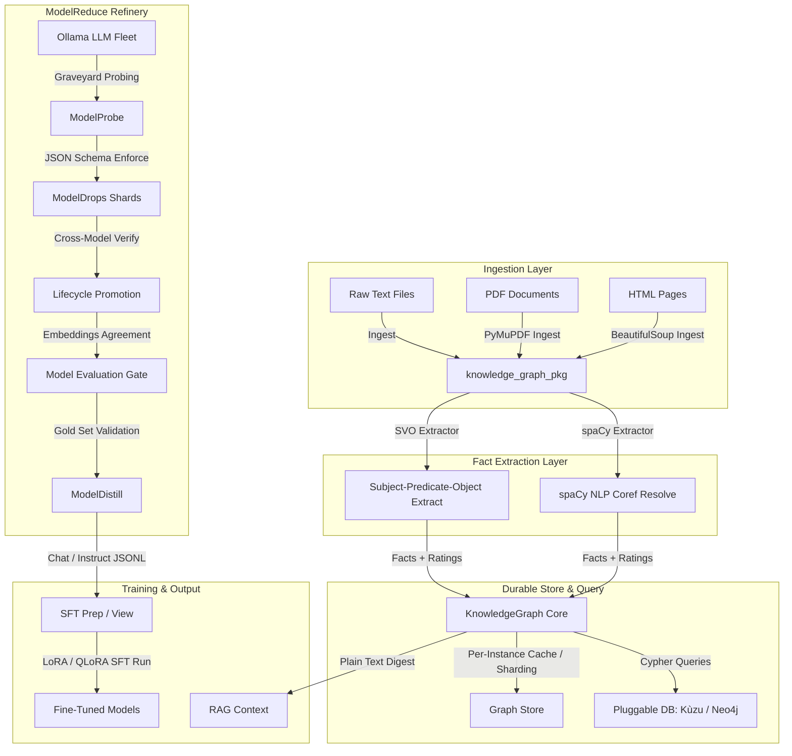

# Architecture: KnowledgeReduce Pipeline & ModelReduce Refineries

This document defines the high-level system architecture, data flow pipelines, directory layouts, and execution modules of the **KnowledgeReduce** and **ModelReduce** package.

---

## 🏛️ System Topology

The platform integrates document ingestion, semantic fact extraction, reliability rating schemas, persistent graph storage, LLM-based model probing, evaluation pipelines, and fine-tuning dataset generation.



---

## 📂 Project Directory Structure

```
├── pyproject.toml              # Dependencies, package metadata, ruff/coverage/mypy/pytest settings
├── CONTRIBUTING.md             # Developer playbook & local setup guide
├── ARCHITECTURE.md             # System topology and modular design reference
├── lessons_learned.md          # Registry of implementation and debugging insights
├── data/
│   ├── gold_biochem.json       # Labeled biochemistry gold set for model evaluation
│   └── gold_set.json           # Gold set for SVO/coref extraction F1 evaluation
├── docs/
│   ├── ROADMAP.md              # V1 development milestones roadmap
│   ├── ROADMAP-v2.md           # V2 ongoing factory store roadmap
│   ├── model_reduce_training.md# Tutorial guide for training models on distilled shards
│   └── plans/                  # Audit master plan, checklist & verified walkthroughs
├── knowledge_graph_pkg/        # Main source package
│   ├── cli.py                  # Entrypoint CLI command routing (`knowledgereduce`)
│   ├── core.py                 # Core KnowledgeGraph structures and Reliability Ratings
│   ├── store.py                # Durable file-based drop store & audit summaries
│   ├── catalog.py              # SQLite catalog indexing & querying over drops
│   ├── lifecycle.py            # Store re-extraction & lifecycle verification
│   ├── factstore.py            # FactStore bridge & high-level capture helpers
│   ├── schemas.py              # Canonical schema & JSON Schema definitions
│   ├── ingest.py               # Document loading helpers (Text, HTML, PDF)
│   ├── extraction.py           # Subject-Predicate-Object (SVO) parser
│   ├── extractor_base.py       # Shared Extractor protocol/base interface
│   ├── spacy_extractor.py      # Optional SpaCy & Coreference resolution backend
│   ├── coref.py                # Lightweight pronoun/entity coreference resolver
│   ├── evaluation.py           # Gold-set precision/recall/F1 extractor evaluation
│   ├── distillation.py         # Fact filtering, deduplication, and token ranking
│   ├── export.py               # File export formatting (chat, instruction, plain text)
│   ├── quality.py              # FactQualityFilter quality scoring & filtering
│   ├── qa.py                   # Question-answering helper & digest assembly
│   ├── semantic.py             # Semantic extraction, similarity & enrichment
│   ├── enhanced.py             # EnhancedKnowledgeGraph with per-instance caching
│   ├── utils.py                # JSON/CSV import/export & URL helpers
│   ├── vector.py               # VectorKnowledgeGraph semantic search & clustering
│   ├── streaming.py            # Thread-safe StreamingKnowledgeGraph event processor
│   ├── sharding.py             # ShardedKnowledgeGraph partition & rebalance manager
│   ├── blockchain.py           # BlockchainKnowledgeGraph ledger & integrity proofs
│   ├── analysis.py             # Graph analytics & entity similarity utilities
│   ├── visualization.py        # Matplotlib / GEXF / GraphML export utilities
│   ├── factory.py              # Durable batch drop, catalog, and compilation pipeline
│   ├── graph_store_base.py     # BaseGraphStore abstract class & canonical fact normalization
│   ├── graph_store_factory.py  # get_graph_store factory mapping connection strings/URIs
│   ├── kuzu_store.py           # Kùzu graph database connector (inherits BaseGraphStore)
│   ├── neo4j_store.py          # Neo4j server graph database connector (inherits BaseGraphStore)
│   ├── graph_tool.py           # Read-only Cypher query & MCP tool layer (GraphTools)
│   ├── mcp_server.py           # FastAPI / stdlib MCP server, WebSockets & 3D WebGL Dashboard
│   ├── entity_resolution.py    # Prefix-blocked boundary-aware alias deduplication
│   ├── ontology.py             # Case-insensitive OntologyDistiller hierarchy builder
│   ├── rag.py                  # Hybrid PageRank + vector GraphRAGRetriever & formatters
│   ├── graph_compiler.py       # Cycle-free subgraph & conflict compilation into SFT JSONL
│   ├── watcher.py              # Watchdog / WAL SQLite directory watcher & graph pipeline
│   ├── model_probe.py          # Probing fleet (Ollama/Gemini/OpenAI/llama.cpp backends)
│   ├── probe_templates.py      # Domain-parameterized schemas and probe prompts
│   ├── critique.py             # Fail-closed FactCritic verification engine
│   ├── consensus.py            # Multi-engine consensus probing & store orchestration
│   ├── model_drop.py           # Immutable model drops (shards)
│   ├── cross_model.py          # Cross-model agreement and clustering
│   ├── embeddings.py           # Vector embedding wrappers & NumPy VectorIndex
│   ├── model_distill.py        # Agreement-based shard distillation
│   ├── model_eval.py           # Gold set validation and quality gating
│   ├── training_prep.py        # Token budget and MLX/SFT training format preparation
│   ├── train.py                # MLXTrainer fine-tuning wrapper
│   ├── crawler.py              # Model weight crawler with logprob entropy pruning
│   └── graveyard.py            # Async model checkpointing and daemon discovery
├── scripts/
│   ├── run_suite.py            # Sequential stage-based test runner script (Stages 1–4)
│   ├── smoke_skill.py          # Offline Hermes skill & SemVer smoke verification
│   ├── mirror_skill.py         # Sync canonical Hermes skill into local Hermes config
│   ├── test_drive.py           # Offline smoke drive for core graph & Kùzu stores
│   ├── download_and_crawl.py   # Model download and entropy crawl helper
│   ├── train_mlx.py            # Apple Silicon MLX fine-tuning runner
│   ├── train_sft.py            # PyTorch/PEFT LoRA SFT execution script
│   ├── github_pr_helper.py     # Maker/Checker GitHub PR creation & audit helper
│   └── hooks/
│       └── pre_pr_safety_gate.py # Antigravity PreToolUse branch & meta-test gate
└── tests/                      # Stratified test suite (57 test files incl. tests/meta/)
```

---

## ⚙️ Core Modular Pipelines

### 1. Document Ingestion & Extraction (V1 Core)
Reads files (`.txt`, `.html`, `.pdf`) and feeds them into semantic extractors. The SVO parser uses rule-based parsing to extract relationships, while the spaCy parser provides full entity resolution, dependency structures, and coreference resolution (mapping pronouns like "she" or "it" back to the original entities to maintain fact independence).

### 2. KnowledgeGraph & Database Store
Facts are saved in a `KnowledgeGraph` backed by NetworkX. Reliability levels (e.g. `VERIFIED`, `LIKELY_TRUE`, `UNVERIFIED`) rating fact quality are assigned. Ingestion/catalog operations compile graphs into a KùzuDB instance, allowing Cypher query capabilities and fast path traversals.

### 3. ModelReduce Refinery (V2 Core)
ModelReduce targets local models (via Ollama) and prompts them using structured schemas to extract domain-specific knowledge facts. Probes are saved as drops. The pipeline:
1. **ModelProbe**: Extract raw JSON facts using schema enforcement.
2. **CrossModel Verification**: Group facts via embeddings cosine similarity and count how many models agree on a statement.
3. **Model Evaluation Gate**: Run against a local gold set. If agreement metrics don't meet target precision bounds, the gates fail (preventing downstream training on corrupted or hallucinated data).
4. **Distillation**: Output clean training datasets for fine-tuning.
